# HomelyHub

HomelyHub is a MERN rental-property application for discovering accommodation,
managing listings, booking available dates, and planning trips. Its browser
client is a React single-page application; an Express API owns authentication,
authorization, property and booking data, Razorpay payment confirmation, refund
processing, and Groq-backed AI requests.

> **Implementation note:** This documentation describes the repository source
> and declared configuration. It does not certify a deployed instance, live
> payment behavior, or MongoDB transaction/concurrency behavior.

## Project goals and users

The application brings property discovery, host listing management, guest
bookings, online payment, and trip planning into one web experience. Guests
browse listings, reserve dates, pay, and review or cancel their bookings.
Administrators manage listings and user roles. Local developers and maintainers
can run the React and Express applications independently.

## Features

| Area | Implemented behavior |
| --- | --- |
| Accounts | Registration, login, current-user lookup, profile/password changes, password recovery, logout, access-token refresh, and server-side session revocation. |
| Authorization | User/admin roles; protected routes; audited, paginated admin user management; a CLI bootstrap command for promoting an existing account. |
| Property discovery | Public listing and detail endpoints with filtering/query support; property pages include location/map and listing information. |
| Listing management | Admin-only listing and accommodation operations, ImageKit integration, and archival behavior that preserves listings with active reservations. |
| Booking | Authenticated booking reads, checkout holds, server-side order/amount preparation, payment verification, availability rechecks, and confirmation. |
| Payments and refunds | Razorpay Checkout, HMAC signature checks, payment and refund webhooks, durable refund tasks, worker retries/reconciliation, and customer cancellation. |
| AI | Groq-backed trip planning and AI property-description generation with request limits, usage accounting, and output validation. |
| Operations | Health/readiness endpoints, request IDs, structured logs, centralized error handling, environment checks, syntax checks, backend tests, and GitHub Actions CI. |

## Technology stack

Versions below are the dependency ranges declared in the repository manifests,
not necessarily the exact installed versions.

| Layer | Technologies |
| --- | --- |
| Frontend | React `^18.2.0`, Vite `^6.3.5`, React Router `^6.26.1`, Redux Toolkit `^2.8.2`, React Redux `^9.3.0`, Axios `^1.20.0` |
| UI and browser integrations | Ant Design, Leaflet/React Leaflet, GSAP, React Hot Toast, date pickers, Lucide icons |
| Backend | Node.js (CI uses Node 20), Express `^5.2.1`, Mongoose `^9.9.3` |
| Validation and security | Zod `^4.6.7`, bcrypt `^6.0.0`, jsonwebtoken `^9.0.3`, Helmet `^8.3.0`, CORS, express-rate-limit |
| Persistence | MongoDB via Mongoose |
| Payments | Razorpay Node SDK `^2.9.8`, Razorpay Checkout.js in the browser |
| AI | Groq SDK `^1.6.0` |
| Media and email | ImageKit SDKs, Nodemailer, Mailgen |
| Testing and quality | Node's built-in test runner, c8 coverage, ESLint, GitHub Actions |

## Architecture

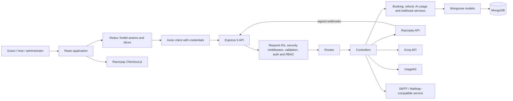

### Request lifecycle

The frontend routes render React components. Feature actions use Redux for
shared state and call the shared Axios client. Express middleware assigns a
request ID, configures security/CORS/body parsing, applies rate limits and
NoSQL sanitization, and retains the raw JSON body needed to verify Razorpay
webhook signatures. Mounted routers apply authentication, role checks and Zod
validation before controllers call services/models or external integrations.
Centralized error handling creates consistent API errors.

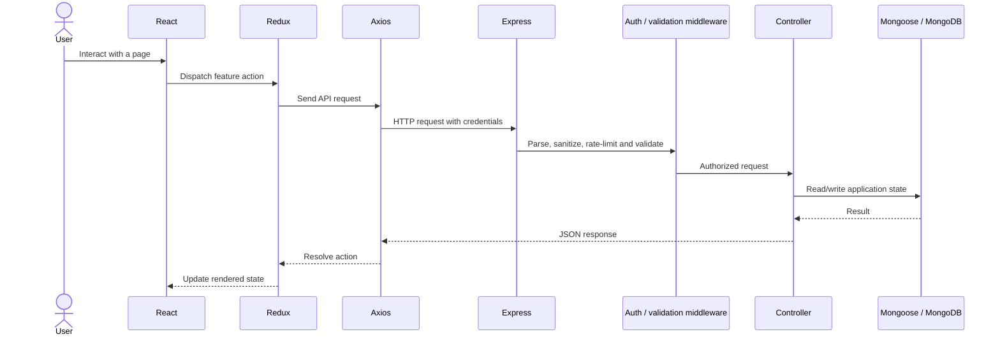

## Repository map

Generated files, dependency directories, and `.git` are intentionally omitted.
Each major source folder links to its folder-level guide.

```text
HomelyHub/
├── .github/
│   └── workflows/
├── backend/
│   ├── src/
│   │   ├── ai/
│   │   ├── controllers/
│   │   ├── models/
│   │   ├── routes/
│   │   ├── scripts/
│   │   ├── services/
│   │   └── utils/
│   └── tests/
└── frontend/
    ├── public/
    │   ├── assets/
    │   └── readme/
    └── src/
        ├── ai/
        ├── assets/
        ├── components/
        │   ├── accomodation/
        │   ├── aiTripPlanner/
        │   ├── home/
        │   ├── myBookings/
        │   ├── payment/
        │   ├── propertyListing/
        │   └── user/
        ├── css/
        ├── data/
        ├── store/
        │   ├── Accomodation/
        │   ├── Booking/
        │   ├── Payment/
        │   ├── Property/
        │   ├── PropertyDetails/
        │   └── User/
        └── utils/
```

- [Backend guide](backend/README.md) → [backend source](backend/src/README.md),
  [routes](backend/src/routes/README.md), [models](backend/src/models/README.md),
  [services](backend/src/services/README.md), [tests](backend/tests/README.md).
- [Frontend guide](frontend/README.md) → [frontend source](frontend/src/README.md),
  [components](frontend/src/components/README.md),
  [Redux store](frontend/src/store/README.md), [AI helpers](frontend/src/ai/README.md).
- [GitHub Actions workflow](.github/workflows/ci.yml) — automated checks on
  pushes and pull requests.

The source does not define separate `pages/`, `hooks/`, or backend `config/`
directories; routing and feature pages live in the documented application
modules.

## Authentication and authorization

Authentication is implemented by the user routes, auth controller, token
utilities, and `AuthSession` model. Passwords are hashed with bcrypt. Login
issues a JWT access token and an opaque refresh token. Both are stored in signed
`HttpOnly`, `SameSite=Strict` cookies; `Secure` is enabled in production. The
current cookie path is `/api/v1/rent`. Access expiry defaults to 15 minutes
(configurable through `JWT_ACCESS_EXPIRES_IN`, constrained to 1 second–1 hour);
refresh/session expiry defaults to 30 days (through
`JWT_REFRESH_EXPIRES_DAYS`, constrained to 1–90 days). Refresh tokens are
random values whose SHA-256 hashes are persisted. Refresh consumes the prior
token and creates a replacement; reuse/invalidity is rejected and can revoke
the session. Logout revokes the identified session and clears both cookie names
at `/api/v1/rent` and `/api/v1/rent/user`. The frontend Axios client sends
credentials and shares a refresh request when an authenticated request needs
refreshing. See the [token implementation guide](backend/src/utils/README.md#authentication-cookies-and-sessions)
for exact behavior and a current test/implementation mismatch.

The `protect` middleware authenticates private routes. `restrictTo("admin")`
gates administrator operations. Signup assigns ordinary user privileges rather
than accepting an administrator role from the client. Admins can list users and
change roles through audited endpoints; a role-lock and transaction protect
concurrent role changes, and the last administrator cannot be demoted.

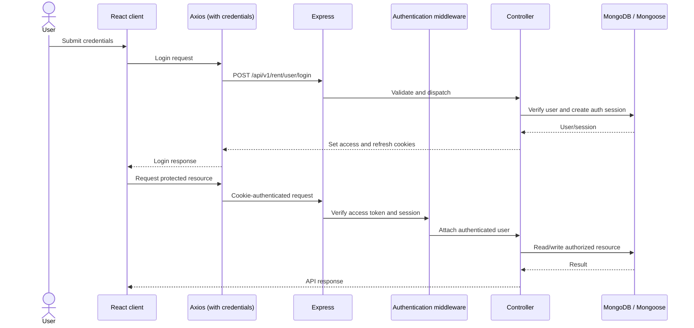

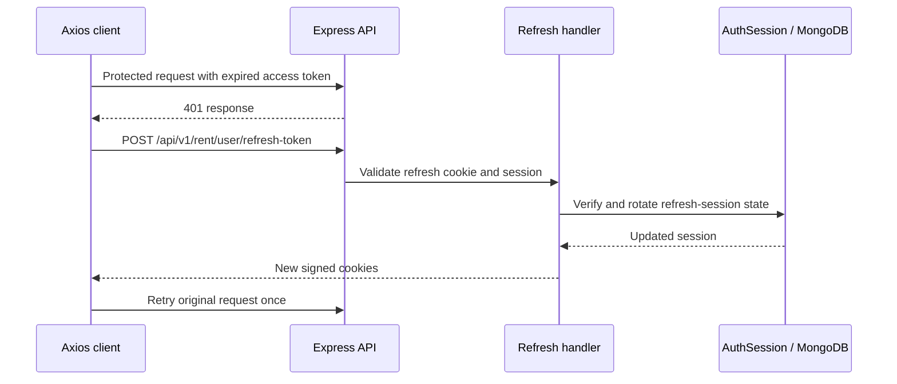

The current auth lifecycle suite has two failing assertions: it expects the
access-cookie path `/api/v1/rent/user` rather than the implementation's
`/api/v1/rent`, and expects two logout cookie-clear calls rather than the
implementation's four calls (two names at two paths). These are documented
source/test discrepancies, not claimed passing behavior.

The CLI bootstrap command is for authorized initial provisioning; it is not a
public registration bypass. Register the target account first, then, from
`backend/`, use `node src/scripts/promoteAdmin.js <registered-email>` against
the intended database. The script requires a transaction-capable MongoDB
deployment. For normal role changes, use the protected admin API. See
[admin/user routes](backend/src/routes/README.md) and
[backend scripts](backend/src/scripts/README.md).

## Razorpay payments, booking confirmation, and refunds

### Checkout and confirmation

1. The authenticated client requests an order through
   `POST /api/v1/rent/user/booking/create-order`.
2. The backend validates property/dates, calculates the amount from persisted
   property pricing, and creates a temporary checkout hold with expiry.
3. The client opens Razorpay Checkout.js with the backend-created order.
4. After checkout, the client sends the returned order ID, payment ID, and
   signature to `POST /api/v1/rent/user/booking/verify-payment`.
5. The backend verifies the HMAC signature and payment details; the shared
   booking-confirmation service rechecks availability and confirms the booking
   transactionally. A duplicate confirmation is idempotent and cannot replace
   the original payment ID.
6. If payment succeeded but the property is no longer available, the backend
   does not confirm the booking; it creates/reconciles a refund task for
   recovery.

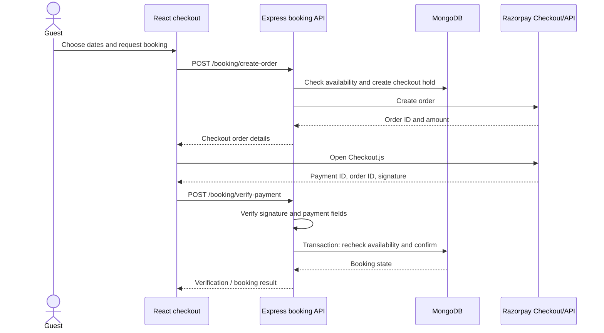

### Payment verification and booking lifecycle

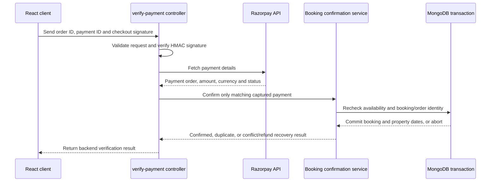

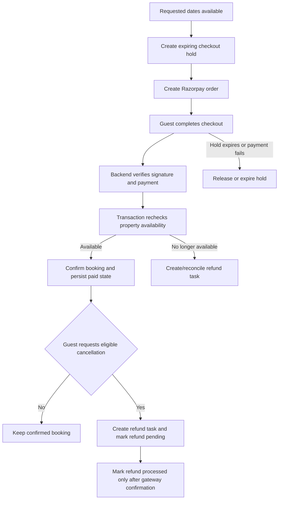

### Verification and webhooks

The browser's success callback is not by itself proof of payment. The backend
verifies the payment signature and validates captured status, order ID, amount,
and INR currency. The webhook route remains public for Razorpay delivery, but
checks the HMAC using the raw request body and dedicated
`RAZORPAY_WEBHOOK_SECRET`. Event IDs are claimed and tracked with leases and
ownership tokens; duplicate events are acknowledged without repeating
state transitions, and failed/expired processing can be retried. Payment
events and refund events share the signature-protected webhook boundary.

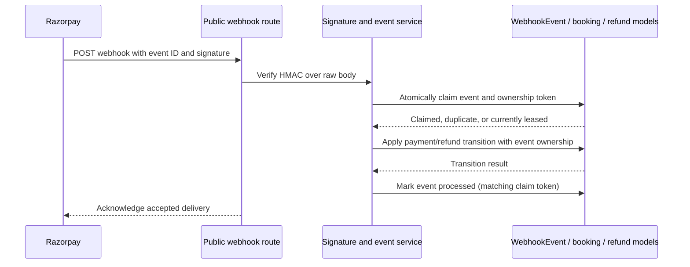

### Cancellation and refunds

`POST /api/v1/rent/user/booking/:bookingId/cancel` verifies ownership, booking
eligibility, cancellation cutoff, and the stored captured payment. The full
refund amount is calculated by the backend; the frontend cannot set it. The
default rule allows full-refund cancellation at least 24 hours before check-in,
configurable with `BOOKING_CANCELLATION_CUTOFF_HOURS`.

The transaction changes the booking to `refund_pending`, creates one durable
refund task per payment, records cancellation metadata, and releases reserved
dates. The worker claims tasks with lease ownership, reconciles existing
Razorpay refunds before retrying, and uses an idempotency key. A refund is
marked processed only after gateway reconciliation or a valid processed-refund
webhook. Refund webhooks are matched to the related payment and order and are
protected against duplicate/out-of-order updates.

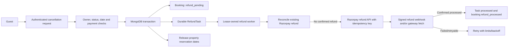

MongoDB transactions are required for booking confirmation, cancellation/refund
task creation, and other transactional workflows. Use a replica set or
compatible MongoDB service; standalone MongoDB cannot provide the same atomic
guarantees. Unit tests use mocks and do not prove transaction or concurrency
behavior against a real database.

## AI Trip Planner

The React trip-planner components submit validated requests to the authenticated
trip API. The user router also exposes a `createTripPlan` path to the same
controller. Route middleware applies rate limits and per-user daily usage
accounting. Backend AI helpers construct prompts, escape untrusted input,
request structured output from Groq, and validate/parse the result before
returning it. The trip controller can enrich the request with property data.
AI output is not independently verified for factual accuracy.

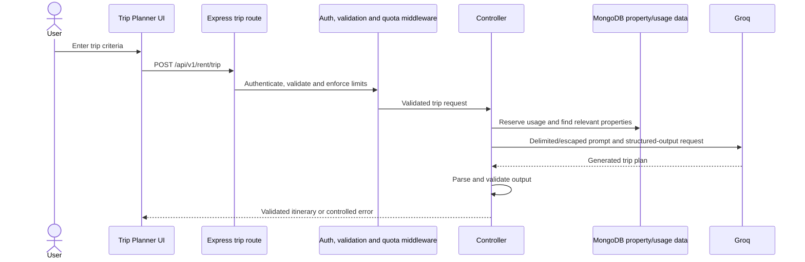

## Database model overview

The model directory contains the following Mongoose collections. Field-level
types, validation, defaults, indexes, and model-specific behavior are listed in
[the model guide](backend/src/models/README.md).

| Model | Responsibility and relationships |
| --- | --- |
| `User` | Account identity, credential and role data; referenced by sessions, bookings, AI usage, and role audit records. |
| `AuthSession` | Server-side session and refresh-token state associated with a user. |
| `Property` | Accommodation listing data and booking/reservation date state. |
| `Booking` | Guest/property booking, payment, hold, and cancellation lifecycle. |
| `RefundTask` | Durable refund attempt, lease, retry, and Razorpay reconciliation state associated with a booking/payment. |
| `WebhookEvent` | Event identity, processing state, lease, and claim ownership for webhook idempotency. |
| `AIUsage` | Per-user AI request/token accounting. |
| `RoleChangeAudit` | Administrator role-change actor, target, old/new role, and request/source metadata. |
| `AdminRoleLock` | Coordination record for serialized admin-role updates. |

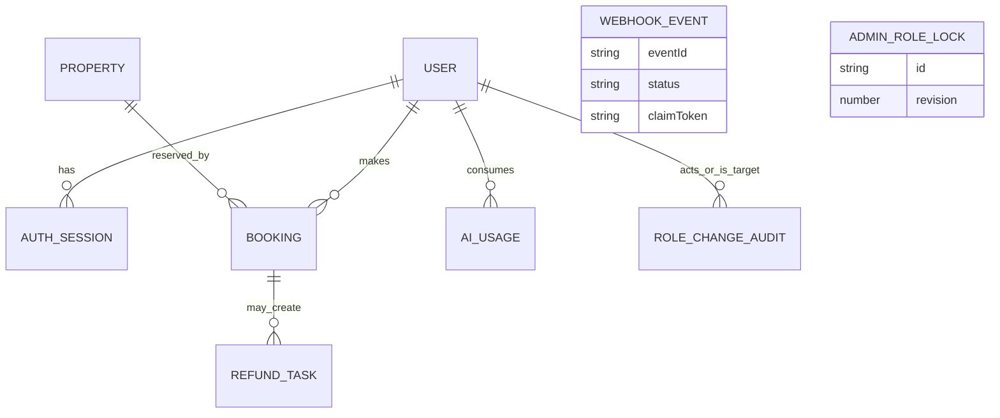

The webhook event and role lock models are coordination records rather than
foreign-key relationships. See the model guide before relying on any
field-level or index-specific behavior.

## API reference

The router overview below groups the implemented API. The backend
[routes guide](backend/src/routes/README.md) records the route mounts, methods,
auth requirements, and handler flow; folder-level
[controller](backend/src/controllers/README.md) and
[validation](backend/src/utils/README.md) guides identify request schemas and
response behavior. Routes are mounted under `/api/v1/rent` unless noted.

| Group | Method and path | Access | Purpose |
| --- | --- | --- | --- |
| Auth | `POST /user/signup`, `POST /user/login` | Public, rate-limited | Register and authenticate. |
| Auth | `GET` or `POST /user/logout`, `POST /user/refresh-token` | Cookie/session | Revoke session/clear cookies; rotate tokens. |
| Account | `GET /user/me`, `PATCH /user/updateMe`, `PATCH /user/updateMyPassword` | Authenticated | Read current account and update profile/password. |
| Password recovery | `POST /user/forgotPassword`, `PATCH /user/resetPassword/:token` | Public, rate-limited | Request and apply password reset. |
| Admin users | `GET /user/admin/users`, `PATCH /user/admin/users/:userId/role` | Admin | Paginated user list and audited role change. |
| Listings | `GET /listing`, `GET /listing/:id` | Public | Search/list and retrieve property details. |
| Listings | `POST /listing`, `PATCH /listing/:id`, `DELETE /listing/:id` | Admin | Create, update, and delete/archive a listing. |
| Accommodations | `POST /user/newAccommodation`, `GET /user/myAccommodation` | Authenticated/admin | Create and list an administrator's accommodations. |
| AI description | `POST /user/generateDescription` | Authenticated/admin, limited | Generate a listing description. |
| Trip planning | `POST /trip`, `POST /user/createTripPlan` | Authenticated, limited | Generate a validated trip plan. |
| Bookings | `GET /user/booking`, `GET /user/booking/:bookingId` | Authenticated, owner-scoped | List and fetch bookings. |
| Checkout | `POST /user/booking/create-order`, `POST /user/booking/verify-payment` | Authenticated, payment-limited | Create an order/hold and verify a gateway payment. |
| Cancellation | `POST /user/booking/:bookingId/cancel` | Authenticated, owner-scoped | Request policy-eligible cancellation and refund. |
| Webhook | `POST /user/booking/webhook` | Public delivery; signed payload required | Process verified Razorpay payment/refund events. |
| Operations | `GET /`, `GET /health`, `GET /ready` | Public | Root, liveness, and readiness responses. |

For exact request and response schemas, check the route/controller files before
integrating; the route table is not a substitute for their validation logic.

## Security architecture

- bcrypt password hashing; JWT access/refresh lifecycle with server-side
  sessions and refresh revocation.
- Signed HttpOnly cookies and credentialed CORS configured for the frontend.
- `protect` and role middleware enforce access on the server.
- Zod request validation rejects invalid/unknown input; NoSQL operator
  sanitization and endpoint rate limits provide additional controls.
- Helmet adds HTTP security headers; CORS uses configured origins.
- Payment and webhook HMAC signatures are verified using timing-safe
  comparisons. Webhook processing uses the raw body and a dedicated webhook
  secret.
- Centralized `AppError` handling and structured request-ID logging avoid
  returning internal errors or secrets to clients.
- Environment validation checks required setting names and formats without
  logging secret values.

### Security and verification boundaries

- MongoDB transaction and real concurrency guarantees have not been verified by
  a replica-set integration suite.
- Razorpay Test Mode payment/refund flows require manual gateway verification;
  no live payment behavior is certified by this documentation.
- Groq output validation constrains structure, not factual accuracy.
- The backend 80% statement-coverage threshold is configured; consult the
  current test/coverage run before treating it as met.
- `frontend/src/components/propertyListing/PropertyListing.jsx` references
  `/assets/placeholder.jpg`, which the frontend documentation reports as
  absent from the repository; verify the fallback asset before deployment.

## Installation and local setup

### Prerequisites

- Node.js 20 or a compatible version supported by the project.
- npm.
- MongoDB with transaction support for booking confirmation and refund flows.
- Credentials for the external integrations you intend to exercise: SMTP,
  ImageKit, Groq, and Razorpay. Use test-mode payment credentials for local
  payment testing.

### Clone and install (Windows PowerShell)

```powershell
git clone https://github.com/asfahana01/HomelyHub.git
Set-Location HomelyHub

Set-Location backend
npm install
Copy-Item .env.example .env
Set-Location ..\frontend
npm install
```

Edit `backend/.env` locally with the required settings from
[`.env.example`](backend/.env.example). Do not commit the file or paste its
values into issues, logs, or documentation. The repository has no frontend
test script. Backend configuration names and requiredness are summarized in
the [backend guide](backend/README.md#configuration-names).

### Start both applications

Open two PowerShell terminals:

```powershell
# Terminal 1
Set-Location HomelyHub\backend
npm run dev
```

```powershell
# Terminal 2
Set-Location HomelyHub\frontend
npm run dev
```

The frontend Vite configuration proxies `/api` requests to the local backend
on port 3000. Use the actual frontend URL and origins configured by the
backend environment.

### Razorpay webhook testing

Configure a publicly reachable webhook URL ending in
`/api/v1/rent/user/booking/webhook`, use the same dedicated webhook secret in
the Razorpay dashboard and backend environment, and subscribe to payment and
refund events implemented by the handler. For local development, expose the
local backend through a secure webhook tunnel or use Razorpay's supported
webhook testing facility. Never disable signature verification or use live
credentials for test requests.

## Deployment

The repository includes GitHub Actions CI but does not define a complete
hosting platform or infrastructure-as-code deployment. A deployment needs:

1. A built frontend served over HTTPS and configured to call the deployed API.
2. An Express backend process running `node src/index.js` after installing the
   backend production dependencies.
3. A transaction-capable MongoDB deployment.
4. Environment variables configured in the hosting provider's secret manager.
5. Correct frontend/API origins, credentialed CORS, cookie security and HTTPS
   settings.
6. Razorpay production credentials and a dashboard webhook configured to the
   deployed public webhook route.
7. Valid Groq, ImageKit, and SMTP settings for the integrations in use.

Review cookie domains/paths, CORS origins, database transaction support,
webhook subscriptions, worker cadence, backups, alerting, and log retention
before production use. These are deployment checks, not a claim that a
particular deployment is already configured.

## Testing, linting, and builds

Run commands from the corresponding directory:

```powershell
# Backend
Set-Location backend
npm test
npm run test:coverage
npm run check:syntax
npm run check:env

# Frontend
Set-Location ..\frontend
npm run lint
npm run build
```

Backend tests use Node's `node:test` runner, generally with mocked database and
external integrations. `npm run test:coverage` enforces a configured 80%
statement threshold. The frontend package has lint/build scripts but no test
script. CI runs backend checks/tests/coverage, lints selected frontend files,
and builds the frontend; see the [CI workflow](.github/workflows/ci.yml).

### Troubleshooting

| Symptom | Checks |
| --- | --- |
| Backend does not start | Confirm required environment names are configured, `MONGO_URI` is reachable, and the selected MongoDB deployment supports required transactions. |
| Browser API request fails | Confirm backend port, Vite `/api` proxy, `FRONTEND_URL`/`ORIGIN_ACCESS_URL`, CORS, and cookie settings agree. |
| Login appears lost | Ensure cookies are accepted for the local frontend/API arrangement; try logging in again and check refresh endpoint responses without exposing tokens. |
| Payment verification fails | Use the matching Razorpay order/payment, check INR amount and gateway status, and never treat the frontend callback alone as confirmation. |
| Webhook is rejected | Confirm public reachability, exact webhook secret, correct subscribed event, and raw-body middleware; do not log or share signatures. |
| Refund remains pending | Check worker startup, transaction-capable MongoDB, Razorpay refund state, webhook delivery, retry limit, and server logs using request/event IDs. |
| AI endpoint is rejected | Check Groq configuration, authentication, request schema, rate limits, and per-user usage quota. |

## Future improvements

These are recommendations, not claims about existing features:

- Add MongoDB replica-set integration tests for transaction and concurrency
  guarantees.
- Raise backend statement coverage to its configured threshold and add frontend
  component/API tests.
- Add operational dashboards and alerts for exhausted refund retries and
  webhook delivery failures.
- Verify and restore the missing placeholder image reference or remove the
  fallback path.
- Define and exercise a repeatable deployment/rollback process.

## Project information

Repository: [asfahana01/HomelyHub](https://github.com/asfahana01/HomelyHub).
See [backend](backend/README.md), [frontend](frontend/README.md), and
[the GitHub Actions workflow](.github/workflows/ci.yml) for implementation
details.
